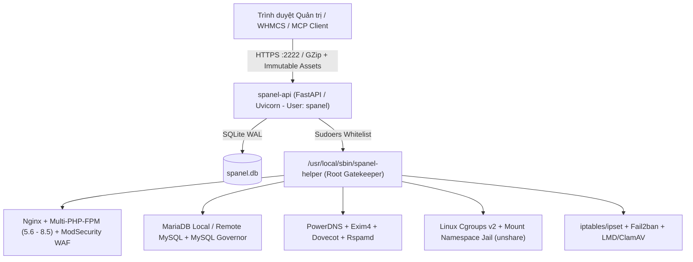

<div align="center">

# SPanel (`v1.0.8`)
### Nền tảng Quản trị Web Hosting & Máy chủ Đa tầng Thế hệ mới cho Ubuntu 24.04 LTS

[](https://github.com/shostwp-byte/spanel)
[](https://ubuntu.com/)
[](https://fastapi.tiangolo.com/)
[](https://react.dev/)
[](docs/ADMIN_AND_CLI_GUIDE.md)
[](LICENSE)

**SPanel** là bảng điều khiển quản trị máy chủ và web hosting hiện đại, hiệu năng cao, được thiết kế chuyên biệt cho **Ubuntu 24.04 LTS**. Hệ thống kết hợp kiến trúc phân quyền **3 cấp độ (Admin / Reseller / End User)** chuẩn DirectAdmin với cơ chế cô lập đặc quyền `spanel-helper`, giới hạn tài nguyên phần cứng **Linux Cgroups v2 & MySQL Governor**, trình quản trị chuyên sâu **WordPress Manager**, hỗ trợ song ngữ **Tiếng Việt / Tiếng Anh**, chế độ **Sáng / Tối (Light / Dark Mode)** và tương thích hoàn hảo trên thiết bị di động (**Mobile-First Responsive**).

[Cài đặt Nhanh](#-cài-đặt-nhanh-quick-start) • [Tính năng Chi tiết](#-danh-mục-tính-năng-toàn-diện) • [Kiến trúc Bảo mật](#-kiến-trúc-hệ-thống--bảo-mật-đa-lớp) • [Tài liệu Kỹ thuật (`docs/`)](#-tài-liệu-kỹ-thuật-docs) • [Báo lỗi & Đóng góp](https://github.com/shostwp-byte/spanel/issues)

</div>

---

## 📋 Mục lục

- [Tổng quan & Điểm khác biệt](#-tổng-quan--điểm-khác-biệt)
- [Kiến trúc Hệ thống & Bảo mật Đa lớp](#-kiến-trúc-hệ-thống--bảo-mật-đa-lớp)
- [Danh mục Tính năng Toàn diện](#-danh-mục-tính-năng-toàn-diện)
  - [1. Phân quyền 3 Cấp độ & Chuyển đổi Vai trò Tức thì](#1-phân-quyền-3-cấp-độ--chuyển-đổi-vai-trò-tức-thì-rbac--access-role-switch)
  - [2. Quản trị Tên miền, Subdomain, Chuyển hướng & SSL/TLS](#2-quản-trị-tên-miền-subdomain-chuyển-hướng--ssltls)
  - [3. WordPress Manager Chuyên sâu (WP-CLI & Bảo mật 1-Click)](#3-wordpress-manager-chuyên-sâu-wp-cli--bảo-mật-1-click)
  - [4. Ngăn xếp Web Đa phiên bản PHP, CustomBuild & Ứng dụng Hiện đại](#4-ngăn-xếp-web-đa-phiên-bản-php-custombuild--ứng-dụng-hiện-đại)
  - [5. Cơ sở dữ liệu MariaDB, Remote MySQL, MySQL Governor & phpMyAdmin SSO](#5-cơ-sở-dữ-liệu-mariadb-remote-mysql-mysql-governor--phpmyadmin-sso)
  - [6. Cô lập Tài nguyên Cgroups v2 & Giám sát Thời gian thực](#6-cô-lập-tài-nguyên-cgroups-v2--giám-sát-thời-gian-thực)
  - [7. Trung tâm Sao lưu, Khôi phục Chi tiết (Granular Restore) & Di chuyển Panel](#7-trung-tâm-sao-lưu-khôi-phục-chi-tiết-granular-restore--di-chuyển-panel)
  - [8. Tường lửa Chủ động, WAF ModSecurity, Fail2ban & Quét Mã độc](#8-tường-lửa-chủ-động-waf-modsecurity-fail2ban--quét-mã-độc)
  - [9. Hệ thống Thông báo Đa kênh (`System Notifications`)](#9-hệ-thống-thông-báo-đa-kênh-system-notifications)
  - [10. Hệ sinh thái Add-ons, Multi-Server, WHMCS & Trợ lý AI (MCP)](#10-hệ-sinh-thái-add-ons-multi-server-whmcs--trợ-lý-ai-mcp)
- [Yêu cầu Hệ thống](#-yêu-cầu-hệ-thống)
- [Cài đặt Nhanh (Quick Start)](#-cài-đặt-nhanh-quick-start)
- [Cập nhật & Công cụ Quản trị CLI](#-cập-nhật--công-cụ-quản-trị-cli)
- [Cấu trúc Thư mục Dự án](#-cấu-trúc-thư-mục-dự-án)
- [Tài liệu Kỹ thuật (`docs/`)](#-tài-liệu-kỹ-thuật-docs)
- [Giới hạn đã biết (Known Limitations)](#-giới-hạn-đã-biết-known-limitations)
- [Giấy phép & Bản quyền](#-giấy-phép--bản-quyền)

---

## 🚀 Tổng quan & Điểm khác biệt

| Tiêu chí | Giải pháp truyền thống | SPanel (`v1.0.8`) |
| :--- | :--- | :--- |
| **Đặc quyền tiến trình Web Panel** | Thường chạy trực tiếp dưới `root` hoặc wrapper rộng | Tiến trình `spanel-api` chạy dưới user không đặc quyền `spanel`, mọi tác vụ hệ thống đi qua cổng kiểm duyệt `/usr/local/sbin/spanel-helper` |
| **Cô lập Người dùng & Website** | Dùng chung pool PHP hoặc quyền thư mục lỏng lẻo | Mỗi khách hàng có **Linux user riêng**, mỗi website chạy **PHP-FPM Unix socket riêng**, Web Terminal cô lập mount namespace (`unshare --mount`) |
| **Kiểm soát Tài nguyên (Noisy Neighbor)** | Cần mua thêm CloudLinux / LVE trả phí | Tích hợp sẵn **Linux Cgroups v2** (`CPU`, `RAM`, `Disk I/O`, `IOPS`, `Tasks`) và **MySQL Governor** miễn phí ngay trong nhân Ubuntu 24.04 |
| **Quản trị WordPress** | Phải cài plugin quản lý rời hoặc thao tác tay | Tích hợp **WordPress Manager** toàn diện: 1-Click SSO, Clone, Snapshot, khoá thực thi PHP trong `uploads`, tắt XML-RPC, Redis Object Cache |
| **Tốc độ Tải Giao diện** | Nặng nề, tải nguyên khối nhiều MB | Kiến trúc **React 19 + Vite Code-Splitting (`React.lazy`) + GZip + Immutable Cache**, gói tải khởi động chỉ **~115 KB** |

---

## 🛡️ Kiến trúc Hệ thống & Bảo mật Đa lớp



- **Nguyên tắc Đặc quyền Tối thiểu (Privilege Separation):** Dịch vụ `spanel-api.service` bị khóa cứng bởi systemd sandbox (`RestrictAddressFamilies`, `RestrictNamespaces=mnt`) và hoàn toàn không có quyền `root`.
- **Kiểm duyệt Tham số Nghiêm ngặt:** Mọi lệnh gọi sang `spanel-helper` đều được kiểm tra định danh tên miền, đường dẫn thực (`realpath`), chống leo thang đặc quyền qua symlink/hardlink và chống tiêm lệnh (Command Injection).
- **Xác thực Đa nhân tố & Chống Giả mạo:** Hỗ trợ **2FA TOTP** (Google Authenticator), khóa bảo mật sinh trắc học **WebAuthn Passkeys**, phiên đăng nhập `HttpOnly + SameSite` tự động gia hạn kèm **CSRF Token** và nhật ký kiểm toán (**Audit Log**) toàn diện.

---

## ✨ Danh mục Tính năng Toàn diện

### 1. Phân quyền 3 Cấp độ & Chuyển đổi Vai trò Tức thì (RBAC & Access Role Switch)

| Nhóm Quyền hạn | Admin (`admin`) | Reseller (`reseller`) | End User (`user`) |
| :--- | :---: | :---: | :---: |
| **Quản trị Máy chủ, Dịch vụ, IP, Name Servers, CustomBuild** | ✅ Toàn máy chủ | ❌ | ❌ |
| **Quản lý Gói Dịch vụ (`Packages`)** | ✅ Gói Reseller & User | ✅ Gói User của đại lý | 🔍 Xem hạn mức cá nhân |
| **Khởi tạo & Quản lý Tài khoản (`Users`)** | ✅ Admin / Reseller / User | ✅ User thuộc đại lý | ❌ |
| **Tuỳ biến Thương hiệu (`White-Label Branding`)** | ✅ Toàn hệ thống | ✅ Riêng cho khách đại lý | 🎨 Hiển thị theo đại lý |
| **Đăng nhập thay thế 1-Click (`Impersonation`)** | ✅ Mọi Reseller & User | ✅ User thuộc đại lý | ❌ |
| **Thanh chuyển đổi góc nhìn (`Access Role Switch`)** | ✅ `Admin` / `Reseller` / `User` | ✅ `Reseller` / `User` | 👤 Giao diện `User` |
| **Khởi tạo Website & Database Hosting** | 🔄 Chuyển sang góc nhìn `User` hoặc gán cho `End User` | 🔄 Chuyển sang góc nhìn `User` hoặc dùng `Login as` | ✅ Trực tiếp |

- **Kiểm toán & Chuyển quyền Sở hữu Tài nguyên (`Owner Transfer`):** Tự động phát hiện các Website/Database từng tạo nhầm dưới tài khoản Admin/Reseller từ phiên bản cũ và hỗ trợ chuyển giao quyền sở hữu 1-click sang đúng tài khoản End User kèm di chuyển thư mục runtime an toàn.

---

### 2. Quản trị Tên miền, Subdomain, Chuyển hướng & SSL/TLS

- **Domain Setup (`/website`):**
  - Quản lý tập trung toàn bộ tên miền chính và tên miền phụ trên cùng một bảng điều khiển chuẩn DirectAdmin.
  - **Đổi tên miền (`Rename Domain`):** Tự động cập nhật cấu hình Nginx vhost, chứng chỉ và thư mục gốc.
  - **Hành động hàng loạt:** Bật/tắt bắt buộc HTTPS (`Force SSL`), đổi phiên bản PHP (`5.6` – `8.5`), bật/tắt cô lập `Open_basedir`, bật/tắt `FastCGI Cache` và xóa tên miền an toàn.
  - **Domain Aliases & Pointers:** Hỗ trợ chế độ song song (`alias`) hoặc chuyển hướng (`redirect`) kèm đồng bộ chứng chỉ SSL.
- **Subdomain Management (`/subdomains`):**
  - Thanh chọn tên miền nhanh (`Top Domain Selector Bar`), tự động chuẩn hóa tiền tố khi người dùng dán cả cụm tên miền phụ.
  - Hỗ trợ thư mục `Document Root` mặc định hoặc tùy chỉnh bên trong không gian lưu trữ của website.
- **Site Redirects (`/redirects`) & Custom Handlers (`/handlers`):**
  - Thiết lập quy tắc chuyển hướng `301 Permanent` / `302 Temporary` và tùy chỉnh phần mở rộng xử lý MIME/PHP trên từng website.
- **Quản lý Chứng chỉ SSL/TLS Toàn diện (`/ssl` & `/server-tls`):**
  - Cấp phát tự động **Let's Encrypt (HTTP-01)** và **Wildcard SSL (Cloudflare DNS-01)**.
  - Hỗ trợ **Shared SSL / Cloudflare Origin Certificate** và tải lên chứng chỉ SSL tùy chỉnh (`Manual CRT / KEY / CA Bundle`).
  - **Server TLS Certificate (`/server-tls`):** Cấp phát và đồng bộ chứng chỉ TLS cho chính cổng giao diện SPanel (`:2222`), Mail Server (Exim4/Dovecot) và các dịch vụ hệ thống.

---

### 3. WordPress Manager Chuyên sâu (WP-CLI & Bảo mật 1-Click)

- **Tự động Nhận diện & Cài đặt 1-Click:**
  - Tự động phát hiện mọi cài đặt WordPress trên tên miền chính, Subdomain và cả thư mục con (ví dụ `/blog`, `/shop`).
  - Cài đặt WordPress mới chỉ với 1 cú nhấp chuột, tự động khởi tạo Database MariaDB, cấu hình `wp-config.php` và tài khoản quản trị.
- **Đăng nhập 1-Click WP-Admin (`SSO`):**
  - Truy cập thẳng vào bảng điều khiển `wp-admin` với quyền quản trị viên mà không cần nhập mật khẩu.
- **Quản lý Vòng đời WordPress Trực tiếp:**
  - Cập nhật phiên bản WordPress Core; cài đặt, bật/tắt, cập nhật và gỡ bỏ **Plugins** & **Themes**.
  - Quản lý danh sách người dùng WordPress, thêm quản trị viên hoặc đặt lại mật khẩu trực tiếp từ SPanel.
- **Cấu hình & Gia cố Bảo mật WordPress 1-Click (`Security Hardening`):**
  - **Maintenance Mode:** Bật/tắt chế độ bảo trì tức thì.
  - **WP_DEBUG & DISALLOW_FILE_EDIT:** Bật/tắt chế độ gỡ lỗi và khóa trình sửa file PHP trong `wp-admin`.
  - **Disable XML-RPC:** Chặn hoàn toàn giao thức `xmlrpc.php` để ngăn tấn công Brute-Force khuếch đại và DDoS Pingback.
  - **Hide WP Version:** Ẩn thông tin phiên bản WordPress khỏi mã nguồn HTML và RSS feeds.
  - **Block PHP Execution in Uploads:** Ngăn chặn tuyệt đối việc thực thi mã độc `.php`, `.phtml`, `.phar` trong thư mục `wp-content/uploads` ở cả tầng Nginx vhost (hỗ trợ cả cài đặt ở thư mục gốc lẫn thư mục con) và `.htaccess`, đồng thời giữ nguyên chế độ `app_type` của website.
  - **Redis Object Cache & System Cron:** Kích hoạt bộ nhớ đệm đối tượng Redis (kèm nút `Flush Cache`) và chuyển đổi `DISABLE_WP_CRON` sang tiến trình Cron hệ thống.
- **Snapshot Nhanh & Nhân bản Website (`Clone WordPress`):**
  - Tạo bản chụp nhanh (**On-Demand Snapshot**) bao gồm mã nguồn và cơ sở dữ liệu nén `.sql.gz`, hỗ trợ tải về hoặc khôi phục 1-click.
  - **Clone WordPress:** Nhân bản toàn bộ website WordPress sang tên miền hoặc subdomain đích, tự động thay thế URL (`search-replace`), kiểm tra nghiêm ngặt chống tấn công symlink/hardlink/UID spoofing và tự động thu hồi database mồ côi nếu quá trình sao chép gặp sự cố.

---

### 4. Ngăn xếp Web Đa phiên bản PHP, CustomBuild & Ứng dụng Hiện đại

- **Multi-PHP Song song (`5.6`, `7.4`, `8.0`, `8.1`, `8.2`, `8.3`, `8.4`, `8.5`):**
  - Mỗi website vận hành trên một pool PHP-FPM độc lập dưới định danh Linux user riêng của khách hàng.
  - Tuỳ chỉnh cấu hình PHP (`memory_limit`, `upload_max_filesize`, `post_max_size`, `max_execution_time`, `disable_functions`), bật/tắt PHP Extensions và quản lý bộ đệm **OPcache** trực tiếp trên giao diện.
- **CustomBuild & Smart PHP Guard (`/custombuild`, `/updates`):**
  - Cài đặt, nâng cấp hoặc gỡ bỏ các nhánh PHP và thành phần dịch vụ ngay trên giao diện quản trị.
  - **Smart PHP Guard:** Tự động kiểm tra và vá lỗi bảo mật cho các nhánh PHP đang hoạt động với cơ chế không gián đoạn dịch vụ (**Zero-Downtime Reload**) và bảo vệ chống lỗ hổng thực thi mã từ xa (`Anti-PHP2SHELL`).
- **Tối ưu Hóa Tự động theo Phần cứng (`Auto-Tuning`):**
  - Tự động tính toán và đề xuất thông số `pm.max_children` cho PHP-FPM cùng `innodb_buffer_pool_size` cho MariaDB dựa trên dung lượng RAM vật lý thực tế của máy chủ.
- **Custom HTTPD Configurations (`/custom-httpd`):**
  - Cho phép Admin xem và chèn chỉ thị Nginx tuỳ chỉnh cho từng website, tự động kiểm tra cú pháp `nginx -t` trước khi nạp lại dịch vụ và tự động hoàn tác nếu cấu hình lỗi.

---

### 5. Cơ sở dữ liệu MariaDB, Remote MySQL, MySQL Governor & phpMyAdmin SSO

- **Quản lý MariaDB Nội bộ & Cụm MySQL Từ xa (`Remote MySQL`):**
  - Tạo, xóa, đổi mật khẩu, khóa/mở khóa tài khoản (`ACCOUNT LOCK`) và theo dõi dung lượng từng cơ sở dữ liệu.
  - Hỗ trợ kết nối tới các máy chủ **Remote MySQL / MariaDB** qua TLS (xác minh chứng chỉ CA), tự động giới hạn địa chỉ IP kết nối theo đúng IP máy chủ web (tuyệt đối không dùng ký tự đại diện `%`).
- **Đăng nhập 1-Click phpMyAdmin (`SSO`):**
  - Truy cập thẳng vào cơ sở dữ liệu trên phpMyAdmin thông qua token dùng một lần có hiệu lực 60 giây (hỗ trợ cả MariaDB nội bộ và Remote MySQL).
- **Nhập / Xuất SQL An toàn (`Safe SQL Import / Export`):**
  - Xuất dữ liệu nén `.sql.gz` và nạp lại file `.sql` / `.sql.gz` trực tiếp trên trình duyệt.
  - Khi nạp SQL, hệ thống tự động lọc bỏ các mệnh đề `DEFINER=` độc hại, từ chối các câu lệnh leo thang đặc quyền (`GRANT`, `REVOKE`, `SUPER`, `SET GLOBAL`, `SHUTDOWN`) và chỉ thực thi dưới quyền tài khoản database của chính khách hàng (không bao giờ fallback sang quyền `root`).
- **MySQL Governor (Kiểm soát Hạn mức Truy vấn & Dung lượng):**
  - Áp đặt giới hạn `MAX_QUERIES_PER_HOUR`, `MAX_UPDATES_PER_HOUR`, `MAX_CONNECTIONS_PER_HOUR` và hạn mức dung lượng lưu trữ MySQL (`mysql_storage_limit_mb`, `mysql_max_db_size_mb`).
  - Tự động chuyển cơ sở dữ liệu sang chế độ khóa ghi (`write_locked`) khi vượt ngưỡng dung lượng quy định và tự động mở khóa khi người dùng giải phóng dung lượng.

---

### 6. Cô lập Tài nguyên Cgroups v2 & Giám sát Thời gian thực

- **Giới hạn Tài nguyên Phần cứng theo Gói & Người dùng (`Linux Cgroups v2`):**
  - Định nghĩa trực tiếp trong từng gói dịch vụ (`User Packages`) hoặc từng tài khoản:
    - **CPU Quota (`cpu_quota_percent`):** Giới hạn phần trăm xung nhịp CPU tối đa được phép sử dụng.
    - **RAM (`memory_high_mb` & `memory_max_mb`):** Ngưỡng tiết lưu bộ nhớ mềm và giới hạn bộ nhớ cứng chống tràn RAM.
    - **Disk I/O & IOPS (`io_read_mbps`, `io_write_mbps`, `iops_read_max`, `iops_write_max`):** Giới hạn băng thông đọc/ghi ổ đĩa và số tác vụ I/O mỗi giây.
    - **Số lượng Tiến trình (`tasks_max`):** Ngăn chặn hiệu quả tấn công Fork Bomb từ một tài khoản khách hàng.
- **Resource Monitor (`/resources`) & Process Monitor (`/processes`):**
  - Theo dõi mức tiêu thụ CPU, RAM, Disk I/O, Băng thông mạng và Inodes theo thời gian thực cho toàn máy chủ cũng như từng tài khoản người dùng.
  - Tự động cảnh báo các tài khoản đang bị tấn công (`Under Attack`) hoặc sắp chạm trần dung lượng ổ đĩa (`Over Quota`).

---

### 7. Trung tâm Sao lưu, Khôi phục Chi tiết (Granular Restore) & Di chuyển Panel

- **Trung tâm Sao lưu 5 Phân khu (`/backups`):**
  1. **User Backups:** Đóng gói toàn diện tài khoản khách hàng (`.tar.gz`) gồm toàn bộ Website, Database MariaDB và Hộp thư Email theo cấu trúc đường dẫn chuẩn `<hostname>/<username>/user-<username>-<timestamp>.tar.gz`.
  2. **Website Backups:** Sao lưu và khôi phục độc lập từng website riêng lẻ.
  3. **Scheduled Backups:** Lập lịch sao lưu tự động định kỳ (hàng ngày/tuần/tháng), hỗ trợ sao lưu toàn phần (`Full`) hoặc gia tăng (`Incremental`) kèm chính sách tự động xoay vòng (`Retention`) giữ lại $N$ bản mới nhất.
  4. **Panel Self-Backup & Verification:** Tự động chụp ảnh cơ sở dữ liệu điều khiển `spanel.db` (tự động tạo bản chụp trước mỗi lần chạy `spanel-update`) và kiểm tra tính toàn vẹn của các bản sao lưu định kỳ.
  5. **Restore & Destinations:** Hỗ trợ lưu trữ tại chỗ (**Local**), máy chủ **SFTP / FTP** từ xa và **S3-Compatible Object Storage** (AWS S3, Cloudflare R2, Wasabi, Backblaze B2, MinIO).
- **Khôi phục Chi tiết (`Granular Restore`) & Kiểm chứng SHA-256:**
  - Cho phép chọn chế độ khôi phục linh hoạt: **Toàn bộ (`Web + DB + Email`)**, **Chỉ mã nguồn Website**, **Chỉ Database MariaDB** hoặc **Chỉ Hộp thư Email**.
  - Kiểm tra mã băm **SHA-256** trước khi giải nén và tự động khôi phục nguyên trạng cấu hình Nginx vhost, chế độ SSL và phiên bản PHP của từng website.
- **Công cụ Di chuyển Hệ thống (`cPanel & DirectAdmin Migration` — `/migration`):**
  - Nhập trực tiếp file sao lưu từ **DirectAdmin** (`user.*.tar.zst`, `.tar.gz`) và **cPanel** (`cpmove-*.tar.gz`, `backup-*.tar.gz`), tự động tái tạo tài khoản, mã nguồn web, cơ sở dữ liệu, hộp thư email và bản ghi DNS.

---

### 8. Tường lửa Chủ động, WAF ModSecurity, Fail2ban & Quét Mã độc

- **Tường lửa `iptables + ipset` (`/firewall`):**
  - Quản lý quy tắc mở/đóng cổng trực quan, chặn/bỏ chặn IP hoặc dải mạng CIDR tức thì.
  - Hỗ trợ nạp danh sách đen (**IP Blocklist URLs**) chứa hàng trăm nghìn địa chỉ IP độc hại vào nhân Linux qua `ipset` với độ trễ xử lý bằng 0.
- **WAF ModSecurity + OWASP CRS & Chống HTTP Flood (`/waf`):**
  - Bật/tắt tường lửa ứng dụng web theo từng tên miền hoặc toàn máy chủ; quản lý bộ luật **OWASP Core Rule Set (CRS)**.
  - Chặn **Bad Bots / AI Crawlers** toàn cục hoặc theo từng website; giới hạn tốc độ truy cập và số kết nối đồng thời (**HTTP Flood Protection**) chống tấn công DDoS tầng 7.
  - Trình phân tích nhật ký truy cập trực quan kèm khả năng xuất báo cáo CSV.
- **Brute Force Monitor (`/brute-force`) & Fail2ban:**
  - Giám sát các nỗ lực đăng nhập sai vào SSH, SPanel, Mail Server và tự động phong tỏa IP tấn công dò mật khẩu.
- **Quét Mã độc Toàn diện (`Malware Scanner` — `/malware`):**
  - Kết hợp **Linux Malware Detect (LMD)** và **ClamAV** để quét mã độc theo yêu cầu, lập lịch quét tự động và giám sát tệp tin tải lên theo thời gian thực.

---

### 9. Hệ thống Thông báo Đa kênh (`System Notifications`)

- **Chuông Thông báo Phân tầng theo Vai trò (Topbar Notification Bell):**
  - Tự động hiển thị thông báo phù hợp với cấp độ quyền hạn hiện tại (`Admin Level`, `Reseller Level`, `User Level`) kèm nút hành động chuyển thẳng tới trang xử lý sự cố.
- **Trung tâm Cấu hình `System Notifications` (3 Tab chuyên biệt cho Admin):**
  - **Tab `General`:** Bật/tắt chi tiết từng sự kiện cảnh báo về hạ tầng máy chủ (*Dịch vụ dừng hoạt động, Ổ đĩa sắp đầy, Tường lửa tắt, Node trong cụm Multi-Server mất kết nối, Bản cập nhật Panel/PHP mới, Sao lưu thất bại, Phát hiện mã độc, Chứng chỉ SSL sắp hết hạn*) và cảnh báo bảo mật tài khoản (*Đăng nhập từ IP lạ, Thay đổi mật khẩu/2FA*).
  - **Tab `Channels`:** Cấu hình kênh nhận cảnh báo cá nhân và toàn máy chủ qua **Email (SMTP)**, **Telegram Bot** và **Custom Webhooks** (hỗ trợ ký xác thực payload bằng chữ ký số `HMAC-SHA256`).
  - **Tab `Delivery log`:** Theo dõi lịch sử gửi thông báo, trạng thái phản hồi và cơ chế tự động thử lại (Retry) khi kênh đích tạm thời gián đoạn.

---

### 10. Hệ sinh thái Add-ons, Multi-Server, WHMCS & Trợ lý AI (MCP)

- **Quản lý Tiện ích Mở rộng (`Add-ons` — `/addons`):**
  - Admin có thể cài đặt, bật hoặc tắt từng tiện ích mở rộng chỉ với 1 cú nhấp chuột; giao diện menu của Reseller và End User sẽ tự động ẩn/hiện đồng bộ:
    - **Application Add-on:** Triển khai ứng dụng **Node.js**, **Python**, **Docker Container** và **Docker Compose** qua Nginx Reverse Proxy.
    - **Email Server Suite:** Máy chủ thư điện tử hoàn chỉnh gồm **Exim4**, **Dovecot**, bộ lọc chống thư rác **Rspamd**, quản lý hộp thư, Forwarders, Autoresponders, tự động ký **DKIM / SPF / DMARC** và **SPanel Webmail (Roundcube SSO trên cổng `2096`)**.
    - **DNS Management (PowerDNS):** Máy chủ DNS Authoritative trên cổng `53`, quản lý bản ghi `A`, `AAAA`, `CNAME`, `MX`, `TXT`, `SRV`, `CAA`, `NS`.
    - **Malware Scanner (LMD + ClamAV)** & **Fail2ban Brute-Force Protection**.
    - **Demo Mode:** Chuyển toàn bộ bảng điều khiển sang chế độ trải nghiệm chỉ đọc (Read-only) an toàn.
- **Multi-Server Cluster (`/multi-server`):**
  - Liên kết nhiều máy chủ SPanel trong một cụm điều khiển để kiểm tra chống trùng lặp tên miền/DNS xuyên máy chủ và quản lý các máy chủ cơ sở dữ liệu **Remote MySQL**.
- **Tích hợp WHMCS Tự động hóa (`/modules/servers/spanel`):**
  - Cung cấp sẵn module WHMCS chính thức hỗ trợ tự động hóa vòng đời dịch vụ: `CreateAccount`, `SuspendAccount`, `UnsuspendAccount`, `TerminateAccount`, `ChangePackage`, `ChangePassword` và đăng nhập **1-Click SSO** từ trang khách hàng WHMCS.
- **AI Assistant & Giao thức MCP (`/mcp`):**
  - Tích hợp máy chủ **Model Context Protocol (MCP)** chuẩn xác thực bằng token cá nhân, cho phép kết nối trực tiếp với **Claude Code**, **Cursor**, **VS Code** hoặc trợ lý AI nội bộ để tra cứu trạng thái và vận hành máy chủ bằng ngôn ngữ tự nhiên.

---

## 💻 Yêu cầu Hệ thống

| Thành phần | Cấu hình Tối thiểu | Cấu hình Khuyến nghị (Production) |
| :--- | :--- | :--- |
| **Hệ điều hành** | **Ubuntu 24.04 LTS** (64-bit, cài mới) | **Ubuntu 24.04 LTS** (64-bit, cài mới) |
| **CPU** | 1 vCPU | Từ 2 – 4+ vCPU |
| **Bộ nhớ RAM** | 1 GB RAM | Từ 2 – 4+ GB RAM (khuyến nghị khi bật Rspamd / ClamAV) |
| **Ổ cứng** | 20 GB SSD | Từ 40+ GB NVMe SSD |
| **Quyền truy cập** | `root` hoặc `sudo` | `root` hoặc `sudo` |

---

## ⚡ Cài đặt Nhanh (Quick Start)

Đăng nhập SSH vào máy chủ **Ubuntu 24.04 LTS** với quyền `root` và thực thi lệnh cài đặt một dòng:

```bash
curl -fsSL "https://raw.githubusercontent.com/shostwp-byte/spanel/refs/heads/main/install.sh?v=$(date +%s)" -o /tmp/spanel-install.sh && sudo env npm_config_legacy_peer_deps=true bash /tmp/spanel-install.sh
```

### Cài đặt Tự động Không tương tác (Unattended Installation)

Phù hợp cho kịch bản tự động hóa Cloud-Init, Ansible hoặc cấp phát VPS hàng loạt:

```bash
curl -fsSL "https://raw.githubusercontent.com/shostwp-byte/spanel/refs/heads/main/install.sh?v=$(date +%s)" | sudo env npm_config_legacy_peer_deps=true bash -s -- \
  --admin-user admin \
  --admin-pass 'MatKhauManh@2026!' \
  --php-default 8.4
```

> [!IMPORTANT]
> Sau khi quá trình cài đặt hoàn tất, đường dẫn truy cập bảng điều khiển (`https://<IP-May-Chu>:2222`) cùng thông tin đăng nhập quản trị viên sẽ được hiển thị trực tiếp trên màn hình và lưu bảo mật tại `/root/login.txt` (`chmod 600`).

---

## 🛠️ Cập nhật & Công cụ Quản trị CLI

SPanel trang bị bộ công cụ dòng lệnh mạnh mẽ giúp quản trị viên vận hành và cứu hộ máy chủ nhanh chóng qua SSH:

| Lệnh CLI | Mô tả Chức năng |
| :--- | :--- |
| `sudo spanel` | Mở menu tương tác quản trị & cứu hộ nhanh (xem thông tin đăng nhập, đổi mật khẩu admin, tắt 2FA khẩn cấp, khởi động lại dịch vụ, xem trạng thái hệ thống). |
| `sudo spanel-update` | Cập nhật SPanel lên phiên bản mới nhất trực tuyến (tự động sao lưu `spanel.db` trước khi cập nhật, chạy migration Alembic và chỉ build lại Frontend khi mã nguồn thay đổi). |
| `sudo spanel status` | Kiểm tra nhanh trạng thái hoạt động của toàn bộ dịch vụ cốt lõi (`spanel-api`, `nginx`, `mariadb`, `php-fpm`, `pdns`, `exim4`, `dovecot`, `redis`). |
| `sudo spanel reset-password <user>` | Đặt lại mật khẩu khẩn cấp cho tài khoản quản trị hoặc người dùng từ SSH. |

> Bạn cũng có thể kiểm tra và nâng cấp phiên bản trực tiếp trên giao diện web tại mục **Server Manager → Maintenance / Panel Updates**.

---

## 📂 Cấu trúc Thư mục Dự án

```text
spanel/
├── backend/                  # Máy chủ API FastAPI (Python 3.12), SQLAlchemy, Alembic & System Services
│   ├── alembic/              # Quản lý phiên bản lược đồ cơ sở dữ liệu (Database Migrations)
│   ├── app/
│   │   ├── api/              # Các bộ định tuyến REST API & WebSocket (Websites, WP Manager, Backups, v.v.)
│   │   ├── core/             # Cấu hình hệ thống, phân quyền RBAC, mã hóa секрет & kết nối SQLite WAL
│   │   ├── models/           # Mô hình thực thể ORM (User, Website, DatabaseAccount, BackupSchedule, v.v.)
│   │   ├── schemas/          # Lược đồ kiểm duyệt dữ liệu Pydantic v2
│   │   ├── services/         # Tầng điều phối dịch vụ hệ thống (Nginx, PHP, MariaDB, Cgroups, WAF, DNS, Mail)
│   │   └── templates/        # Mẫu cấu hình Jinja2 cho Nginx vhost, trang mặc định & Webmail
├── frontend/                 # Giao diện người dùng React 19 + Vite 8 (Code-Splitting, Dark/Light, VI/EN)
│   ├── src/
│   │   ├── components/       # Thành phần giao diện dùng chung (Terminal, AIAssistant, WebsiteSelect, v.v.)
│   │   ├── contexts/         # Quản lý trạng thái ứng dụng (AppContext)
│   │   ├── locales/          # Từ điển đa ngôn ngữ Tiếng Việt (vi.js) & Tiếng Anh
│   │   └── pages/            # 46 phân trang chức năng tải động (React.lazy) cho Admin, Reseller & End User
├── installer/                # Bộ kịch bản cài đặt, cập nhật & cổng bảo mật đặc quyền
│   ├── files/
│   │   ├── spanel-helper.sh  # Cổng kiểm duyệt đặc quyền Root (/usr/local/sbin/spanel-helper)
│   │   ├── spanelctl         # Công cụ quản trị dòng lệnh (/usr/local/bin/spanel)
│   │   └── spanel-update     # Trình cập nhật trực tuyến (/usr/local/bin/spanel-update)
│   ├── install.sh            # Kịch bản cài đặt toàn diện ngăn xếp dịch vụ trên Ubuntu 24.04 LTS
│   └── update.sh             # Kịch bản nâng cấp không gián đoạn dịch vụ (Zero-Downtime Update)
├── modules/                  # Module tích hợp tự động hóa cấp phát hosting
│   └── servers/spanel/       # Module WHMCS chính thức của SPanel
├── tests/                    # Bộ kiểm thử hồi quy tự động (Regression & Security Test Suite)
├── tools/i18n/               # Công cụ kiểm tra và đồng bộ từ điển đa ngôn ngữ
├── docs/                     # Tài liệu kỹ thuật chi tiết & giao diện GitHub Pages
├── install.sh                # Kịch bản bootstrap cài đặt nhanh từ GitHub
└── VERSION                   # Phiên bản phát hành chuẩn SemVer (1.0.8)
```

---

## 📚 Tài liệu Kỹ thuật (`docs/`)

Toàn bộ tài liệu chuyên sâu dành cho Quản trị viên hệ thống và Nhà phát triển được biên soạn tại thư mục [`docs/`](docs/README.md):

1. 📘 [**Tổng quan & Kiến trúc Hệ thống (`docs/README.md`)**](docs/README.md) — Kiến trúc tổng thể, ngăn xếp công nghệ và luồng xử lý.
2. 📗 [**Danh mục Tính năng Chi tiết (`docs/FEATURES.md`)**](docs/FEATURES.md) — Mô tả chi tiết các tính năng theo 3 vai trò Admin, Reseller, End User và hệ thống Add-ons.
3. 📙 [**Hướng dẫn Cài đặt & Cập nhật Trực tuyến (`docs/INSTALLATION_AND_UPDATE.md`)**](docs/INSTALLATION_AND_UPDATE.md) — Quy trình cài đặt trên VPS mới, tham số tự động hóa và cơ chế Online Update.
4. 📕 [**Cẩm nang Quản trị CLI, Bảo mật & Di chuyển Dữ liệu (`docs/ADMIN_AND_CLI_GUIDE.md`)**](docs/ADMIN_AND_CLI_GUIDE.md) — Mô hình bảo mật `spanel-helper`, lệnh cứu hộ `spanel`, tường lửa, WAF và công cụ Migration từ DirectAdmin / cPanel.
5. 📓 [**Tài liệu Provisioning API, WHMCS & MCP AI (`docs/API_AND_WHMCS.md`)**](docs/API_AND_WHMCS.md) — Hướng dẫn tích hợp WHMCS tự động cấp phát hosting và kết nối trợ lý AI qua giao thức MCP.
6. 🌐 [**Cổng thông tin Tài liệu Trực quan (`docs/index.html`)**](docs/index.html) — Giao diện tra cứu tài liệu hỗ trợ GitHub Pages.

---

## ⚠️ Giới hạn đã biết (Known Limitations)

- **Kiến trúc Điều khiển Đơn điểm (Single-Node Control Plane):** SPanel sử dụng SQLite ở chế độ `WAL` (`busy_timeout=15000ms`) cho cơ sở dữ liệu điều khiển (`spanel.db`). Thiết kế này tối ưu cho một máy chủ VPS/Dedicated độc lập (vận hành từ vài chục đến vài trăm website), không hướng tới mô hình cụm điều khiển đa điểm ghi đồng thời (multi-master control plane).
- **Cơ sở dữ liệu MySQL Từ xa (`Remote MySQL`):** Quản trị viên có thể cấu hình máy chủ MySQL/MariaDB từ xa trong **Multi-Server → Remote MySQL** để người dùng chọn khi tạo database mới, đổi mật khẩu, tải/nạp SQL, khóa ghi khi vượt hạn mức, sao lưu/khôi phục và đăng nhập phpMyAdmin SSO. Tuy nhiên, các database được tạo tự động kèm luồng cài đặt nhanh WordPress 1-Click, WHMCS Provisioning hoặc nhập từ gói cPanel/DirectAdmin mặc định vẫn khởi tạo trên MariaDB nội bộ của máy chủ.
- **Hạn mức Ổ đĩa Tầng Kernel (`setquota`):** Cưỡng chế dung lượng đĩa bằng lệnh `setquota` yêu cầu phân vùng `/home` hoặc `/` của máy chủ đã bật cờ mount `usrquota` / `usrjquota`. Trên các môi trường VPS chưa bật `usrquota` ở tầng filesystem, SPanel vẫn cưỡng chế đầy đủ hạn mức dung lượng ở tầng ứng dụng (File Manager, Upload, Giải nén, Khởi tạo Website, Sao lưu và MySQL Governor).
- **HTTP/3 (`QUIC`):** Chỉ thị `listen 443 quic reuseport` và header `Alt-Svc` được kích hoạt tự động khi binary Nginx trên máy chủ có biên dịch module `ngx_http_v3_module` (như gói Nginx mainline chính thức từ `nginx.org`). Với gói Nginx mặc định của Ubuntu chưa bật module này, SPanel tự động phục vụ qua giao thức chuẩn `HTTP/2 + TLSv1.3`.

---

## 🤝 Hỗ trợ, Đóng góp & Giấy phép

- **Báo lỗi & Đề xuất tính năng:** Vui lòng tạo ticket tại [GitHub Issues](https://github.com/shostwp-byte/spanel/issues).
- **Giấy phép Bản quyền:** Mã nguồn **SPanel** được phát hành theo giấy phép **GNU Affero General Public License v3.0 (AGPL-3.0)**. Xem toàn văn giấy phép tại tệp [LICENSE](LICENSE).
