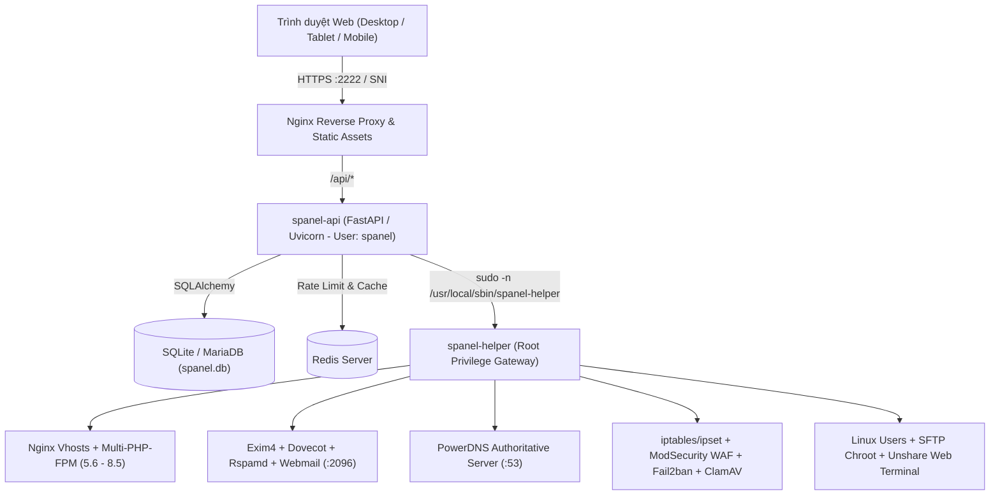

# Tài liệu Kỹ thuật & Hướng dẫn Sử dụng SPanel (`v1.0.60`)

Chào mừng bạn đến với bộ tài liệu chính thức của **SPanel** — nền tảng quản trị máy chủ và web hosting đa tầng dành cho **Ubuntu 24.04 LTS**.

- **Kho lưu trữ GitHub:** [https://github.com/shostwp-byte/spanel](https://github.com/shostwp-byte/spanel)
- **Phiên bản tài liệu:** `v1.0.60`

---

## Danh mục Tài liệu

| Tài liệu | Nội dung chính | Đối tượng |
|---|---|---|
| [**1. Danh mục Tính năng (`FEATURES.md`)**](FEATURES.md) | Chi tiết toàn bộ tính năng theo 3 cấp độ phân quyền (**Admin / Reseller / User**), quản lý Domains & Subdomains chuẩn DirectAdmin, thông báo phân loại và hệ thống Add-ons. | Admin, Reseller, End User |
| [**2. Cài đặt & Cập nhật (`INSTALLATION_AND_UPDATE.md`)**](INSTALLATION_AND_UPDATE.md) | Yêu cầu phần cứng, hướng dẫn cài đặt 1 lệnh trên VPS Ubuntu 24.04 LTS, cấu hình biến môi trường `.env` và quy trình cập nhật trực tuyến (Online Update). | Quản trị viên Hệ thống (SysAdmin) |
| [**3. Quản trị Hệ thống, Bảo mật & CLI (`ADMIN_AND_CLI_GUIDE.md`)**](ADMIN_AND_CLI_GUIDE.md) | Kiến trúc bảo mật tách biệt đặc quyền `spanel-helper`, lệnh cứu hộ `spanel`, tường lửa `iptables + ipset`, WAF ModSecurity và công cụ di chuyển dữ liệu từ DirectAdmin / cPanel. | Quản trị viên Hệ thống (SysAdmin) |
| [**4. Tích hợp WHMCS, API & MCP AI (`API_AND_WHMCS.md`)**](API_AND_WHMCS.md) | Hướng dẫn cấu hình module WHMCS tự động hóa cấp phát hosting, đặc tả REST API Provisioning và kết nối trợ lý AI qua giao thức MCP. | Nhà cung cấp dịch vụ Hosting, Developer |

---

## Kiến trúc Tổng thể của SPanel

SPanel được thiết kế theo nguyên lý **Đặc quyền Tối thiểu (Least Privilege)** và **Cô lập Đa người dùng (Multi-tenant Isolation)**:

### Ngăn xếp Công nghệ (Technology Stack)

| Thành phần | Công nghệ sử dụng | Vai trò trong SPanel |
|---|---|---|
| **Giao diện (Frontend)** | React 19, Vite, CSS Variables | Giao diện SPA tốc độ cao, hỗ trợ Sáng/Tối, Tiếng Việt/Tiếng Anh, tối ưu Mobile & Tablet. |
| **Máy chủ API (Backend)** | Python 3.12, FastAPI, SQLAlchemy, Pydantic v2 | Xử lý nghiệp vụ, phân quyền 3 cấp (RBAC), xác thực JWT/Cookie HttpOnly + CSRF, 2FA TOTP & WebAuthn Passkey. |
| **Cổng đặc quyền (Privilege Gateway)** | Bash (`spanel-helper.sh`), `sudoers` | Thực thi các thao tác hệ thống được kiểm duyệt nghiêm ngặt; ngăn chặn leo thang đặc quyền từ tầng API. |
| **Máy chủ Web & PHP** | Nginx + PHP-FPM (`5.6` đến `8.5`) | Phục vụ website tốc độ cao; mỗi tài khoản chạy pool PHP-FPM riêng với `open_basedir` và quyền user Linux độc lập. |
| **Cơ sở dữ liệu & Bộ nhớ đệm** | MariaDB + Redis + phpMyAdmin | Lưu trữ dữ liệu website, hỗ trợ tự động tinh chỉnh (`auto-tuning`) theo RAM/CPU và đăng nhập phpMyAdmin 1-click. |
| **Bảo mật & Tường lửa** | `iptables`, `ipset`, ModSecurity (OWASP CRS), Fail2ban, ClamAV + LMD | Bảo vệ toàn diện từ tầng mạng (Layer 3/4) đến tầng ứng dụng web (Layer 7) và hệ thống tệp tin. |
| **Dịch vụ Mở rộng (Add-ons)** | PowerDNS, Exim4, Dovecot, Rspamd, Docker, Node.js | Cung cấp DNS Server, Mail Server đầy đủ (DKIM/SPF/DMARC/Webmail SSO) và triển khai ứng dụng Container. |
